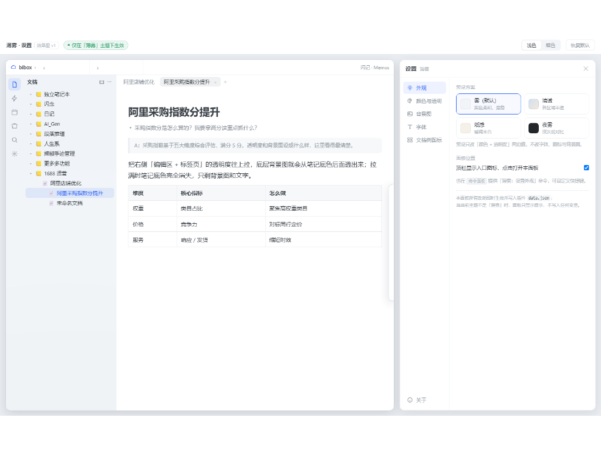

# Mist Settings · 薄雾设置

The control panel for the [**Mist**](https://github.com/dudull852/mist) theme.

**It only works while the Mist theme is active.** Switch to another theme and every value
the plugin wrote is reverted — nothing is left behind in your DOM.

## Theme vs plugin

| Concern | Owner |
|---|---|
| Frameless layout, frosted glass, floating right dock, transparent breadcrumb, top-bar separator | `theme.css` (complete without the plugin) |
| Region colours and opacity, background image, fonts, doc-tree icons, contrast | this plugin (needs a panel and persistence) |

In one line: **the theme is the skin, the plugin is the remote control.** Remove the
remote and the skin must still work.

## Features

0. **The panel opens in the right dock.** Click the toolbar icon, and the settings appear
   on the right while the editor stays on the left — change a number, see it immediately.
   Panel width is draggable and remembered (348px by default). Falls back to a centred
   dialog on mobile or when no dock item is available.
1. **Colours and opacity.** Four independent groups: document tree + left dock, editor +
   tabs, top toolbar, right glass panel. 100% is solid, 0% is fully transparent.
   Clicking a swatch expands an inline colour picker (saturation square, hue bar, hex
   input, eyedropper) right under that row.
   **Five one-click palettes:** Mist / Clear / Paper / wolai-like / Night Mist. A palette
   writes both the light and the dark values and stays tweakable afterwards. Palettes that
   carry an accent colour also override SiYuan's own `--b3-theme-primary`, so native
   buttons, tabs and links change together.
2. **Background image.** Your own picture, scoped to the whole window or to the editor
   only, with fill / fit / tile placement. Uploads are downscaled to 1920px wide and
   re-encoded as JPEG so the settings file does not balloon.
3. **Typography.** Body font and size, document-tree font and size, and an independent
   document-title size.
4. **Doc-tree icons.** Pick the default notebook and document icons from the icon pack you
   have enabled, with search. Only entries without a custom icon are touched; anything you
   set yourself is left alone.
5. **Global contrast.** 0–100, 50 being the theme default. Only text moves, never the
   background.
6. **Separate light and dark values**, switchable at the top of the panel.
7. **Floating panel** — glass for the floating panels: corner radius, blur, saturation,
   opacity, shadow, outer margin, noise grain, plus six pop animations (variant, duration
   and easing configurable, with a *play once* preview).
8. **Title-bar pin** — pin the current floating panel open so it no longer collapses when
   the mouse leaves, which makes tuning much easier. The layout stays floating; only the
   hide is suppressed. Click again to release.

## Install

Install from the SiYuan marketplace, then pick the **Mist** theme under
*Settings → Appearance*. Both packages are needed for the full experience; the plugin
does nothing on other themes.

## Notes

- Everything is written as CSS custom properties on `<html>`; the theme supplies the
  defaults. The plugin never moves nodes or restructures the DOM.
- Settings live in `data/storage/petal/mist-enhancer/settings.json`.
- Requires the Mist theme. Without it the panel still opens but shows *not Mist, settings
  disabled* and writes nothing.

## License

MIT
